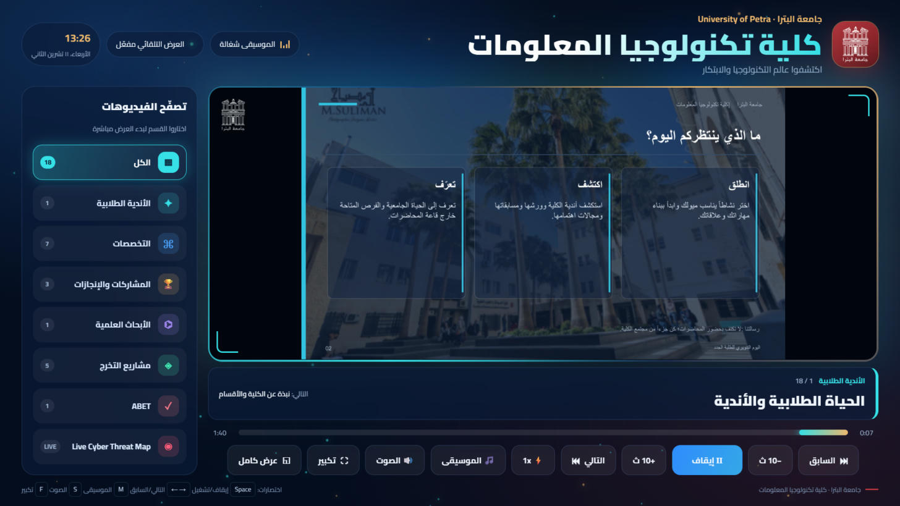

<div dir="rtl">

# شاشة جناح كلية تكنولوجيا المعلومات · جامعة البترا

شاشة عرض لجناح الكلية: فيديوهات الأقسام والتخصصات والإنجازات ومشاريع التخرج، مع موسيقى خلفية بتوقف لحالها لما يشتغل فيديو فيه صوت، وبترجع لما يخلص.



## الروابط

| | |
|---|---|
| 🌐 **تشغيل مباشر من المتصفح** | https://zaidabualshaar.github.io/petra-it-booth/ |
| ⬇️ **تنزيل نسخة كاملة (zip)** | https://github.com/ZaidAbuAlshaar/petra-it-booth/releases/latest/download/petra_it_booth.zip |
| 📁 **المستودع** | https://github.com/ZaidAbuAlshaar/petra-it-booth |

## التشغيل على أي لابتوب (بدون إنترنت)

1. نزّلوا ملف `petra_it_booth.zip` من الرابط فوق.
2. **فكّوا الضغط أولاً**: كليك يمين على الملف ← Extract All.
3. افتحوا المجلد ودبل كليك على **«تشغيل العرض»** ← بيفتح العرض بملء الشاشة والصوت شغال لحاله.
   - على Mac: **«تشغيل العرض - Mac»** (إذا macOS منعه: System Settings ← Privacy & Security ← Open Anyway).
   - للخروج: Alt+F4.

```
petra_it_booth/
├── تشغيل العرض.bat           ← هاد اللي بتكبسوا عليه
├── تشغيل العرض - Mac.command
├── اقرأني.txt
└── app/                      ← الفيديوهات والموسيقى والكود
```

بيحتاج Google Chrome أو Microsoft Edge (موجود على أي Windows). ما بيحتاج إنترنت، إلا قسم Live Cyber Threat Map وتزامن الساعة.

## كيف بتشتغل الموسيقى

- الموسيقى الخلفية شغالة طول الوقت بصوت منخفض.
- الفيديوهات اللي فيها صوت بالأصل (09، 10، 13، 14، 15، 16، 17) ← الموسيقى بتخفت وبتوقف، وصوت الفيديو بيشتغل.
- لما يخلص الفيديو أو حدا يوقفه ← الموسيقى بترجع من نفس المكان اللي وقفت عنده.
- زر الموسيقى فوق (ON / OFF) وزر 🔊 لكتم كل شي.

## تعديل الفيديوهات

القائمة كلها بأول `script.js`. كل فيديو إله سطر فيه العنوان والقسم و`sound: true` إذا فيه صوت. التفاصيل الكاملة في `README_AR.txt`.

## ملاحظات

- الفيديوهات معاد ترميزها H.264 بنفس دقتها الأصلية (لحد أقصى 1080p) حتى تناسب حد GitHub (أقل من 100MB للملف).
- الموسيقى مقطوعات أصلية مولّدة بـ Google Lyria RealTime لهذا المشروع.
- الخط: Cairo (رخصة SIL Open Font License).
- محتوى الفيديوهات والشعار يعود لجامعة البترا · كلية تكنولوجيا المعلومات.

</div>

---

**English:** Booth display for the Faculty of IT, University of Petra. Open the [live version](https://zaidabualshaar.github.io/petra-it-booth/) or [download the zip](https://github.com/ZaidAbuAlshaar/petra-it-booth/releases/latest/download/petra_it_booth.zip), extract it, and double-click «تشغيل العرض» (Windows) or «تشغيل العرض - Mac» (macOS). Background music pauses automatically while a video with its own audio plays and resumes afterwards.
